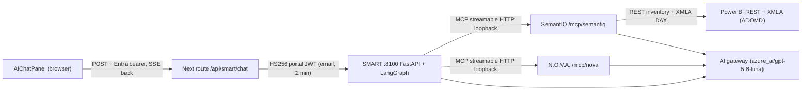
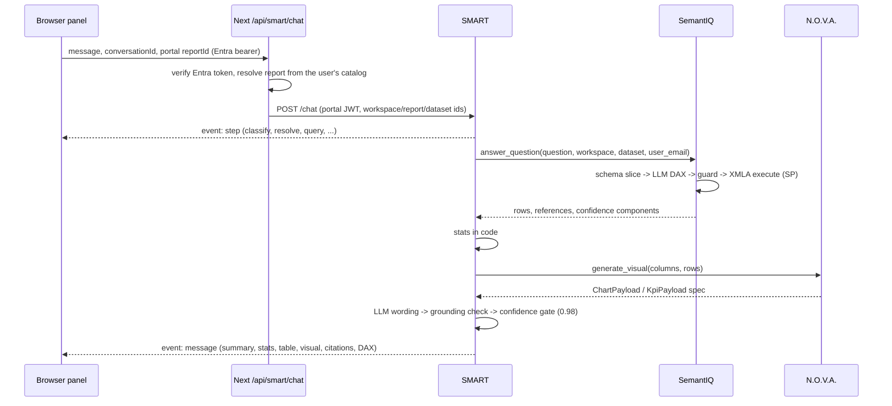

# SMART multi-agent platform

SMART is the assistant in the portal's right-side panel. It is a LangGraph orchestrator that delegates to specialist agents over MCP:

| Agent | Technical id | Role | Port |
|---|---|---|---|
| SMART (unified) | `smart_orchestrator` | Orchestrator HTTP API; mounts SemantIQ and N.O.V.A. MCP | **8100** |
| SemantIQ | `pbi_semantiq_agent` | Discovers and interprets Power BI semantic models; writes, validates and runs read-only DAX | `/mcp/semantiq` on :8100 |
| N.O.V.A. | `pbi_nova_visual_generator` | Turns query results into chart / KPI specs ("Ask. Imagine. Visualize.") | `/mcp/nova` on :8100 |

Per-agent details live in each folder: `README.md` (run and configure), `LOGIC.md` (how it decides), `OUTPUT.md` (what it returns).

## Architecture



Semantic models are not exposed by Microsoft Graph. SemantIQ lists workspaces and datasets via Power BI REST (MSAL, scope `https://analysis.windows.net/powerbi/api/.default`) and runs all DAX—including `INFO.VIEW` metadata—over the XMLA endpoint with the service principal in the ADOMD connection string (same pattern as the XMLA_Test spike). Optional `GRAPH_*` settings are reserved for later use.

## Request sequence



## Model retrieval

SMART picks the semantic model with hybrid search (Pinecone or in-process vectors plus BM25 over titles, menu paths, descriptions, glossary terms and table/column/measure names), then reranks. Every model is classified PROD, DEV or ARCHIVE from token-level name markers (draft, test, dev, v2, archive, backup, ...). Only PROD is searched unless the user explicitly asks for a draft, test, old or archived version, so a draft never wins on similarity alone. Low confidence or several equally good models lead to a question, and the reply resumes the saved workflow. Answers are cached only within the same security scope, dataset, query signature and dataset refresh. Feedback and repeated failures feed a reviewed learning loop that never changes production by itself. Details: [smart_orchestrator/RETRIEVAL.md](smart_orchestrator/RETRIEVAL.md).

## Hallucination control

Confidence is a product of deterministic checks, not a model self-rating:

1. **Narrow context.** The DAX planner sees only the schema slice relevant to the question.
2. **Schema guard.** Every table, column and measure in generated DAX must exist in the model; failures go back to the planner once with the error, then the agent gives up honestly.
3. **Numbers from code.** Stats are computed in Python; N.O.V.A. copies values from rows. The LLM only chooses wording and chart type.
4. **Grounding check.** Every number in the summary must match a row value or computed stat (rounding tolerated). Otherwise the summary is replaced by a template built from the stats.
5. **Gate.** `schema_match x query_success x intent_clarity x grounding` must be at least `CONFIDENCE_THRESHOLD` (0.98). Below it SMART asks a clarifying question with candidate measures instead of guessing.
6. **Transparency.** Answers carry citations, assumptions, the executed DAX and the RLS identity.

## Concurrency and reliability

- Fully async: FastAPI, MCP servers, `httpx.AsyncClient`, `AsyncOpenAI`.
- Bounded: global `MAX_CONCURRENT_REQUESTS`, per-user `USER_REQUESTS_PER_MINUTE` (HTTP 429), per-agent call semaphores, `LLM_MAX_CONCURRENCY`, `PBI_MAX_CONCURRENCY`.
- Timeouts at every hop (`REQUEST_TIMEOUT_S`, `LLM_TIMEOUT_S`, `PBI_TIMEOUT_S`, MCP call timeout); retries with backoff only for idempotent calls and 429/5xx.
- Shared caches: one MSAL token refresh at a time; metadata TTL cache with a per-dataset lock, so concurrent users share one schema load.
- Conversation memory: LangGraph `MemorySaver` keyed by `email:conversation_id`. For several replicas, swap in a Redis/Postgres checkpointer and move the rate limiter to Redis.

## Threat model

| Threat | Control |
|---|---|
| Secrets in code or the browser | Secrets only in git-ignored per-agent `.env` files or real env vars; the browser only talks to the Next route |
| Forged user identity | Next route verifies the Entra token, then signs a 2-minute HS256 JWT (`iss=bi-portal`, `aud=smart-orchestrator`); SMART rejects anything else |
| Querying reports the user cannot see | Workspace/report ids are looked up server-side in the user's own catalog; browser ids are never forwarded |
| Row-level security on semantic models | DAX runs as the Power BI service principal only (no `impersonatedUserName`); RLS is not applied on the portal SMART path |
| Prompt-injected writes or heavy queries | DAX guard: one `EVALUATE`, `DEFINE`/`EVALUATE` only, length cap, `TOPN` row cap; XMLA DAX is read-only |
| Direct calls to agents | Agents bind to 127.0.0.1 by default and require `MCP_SHARED_SECRET` as a bearer token |
| Error detail leakage | Clients get generic messages; details go to structured logs with a request id |
| Overload / abuse | Rate limits, concurrency caps and timeouts listed above |

Rotate the client secrets that are hardcoded in `PO_SPEND_Powerbi_rls_embed_script.py`; they were not copied here.

## Setup and run order

Requires Python 3.11+.

**Local portal (recommended):** `npm run dev` in `apps/portal` starts Next.js and the SMART Python stack on **:8100**. Before starting agents, the dev script creates `%USERPROFILE%\.venvs\smart-agents` when missing and runs `pip install -e .` (includes **pythonnet** for SemantIQ XMLA). Override the interpreter with `SMART_PYTHON`. Set `SMART_AUTO_START_AGENTS=false` to skip auto-start. If `:8100` was already running from an older session, restart it after dependency changes so XMLA code loads.

**Manual Python only** (same venv path as `npm run dev`):

```powershell
cd apps/portal/src/modules/smart-chatbot/agents
.\scripts\start_local.ps1
```

Or create the venv yourself and install once:

```powershell
cd apps/portal/src/modules/smart-chatbot/agents
python -m venv $env:USERPROFILE\.venvs\smart-agents
& "$env:USERPROFILE\.venvs\smart-agents\Scripts\pip.exe" install -e ".[dev]"
python scripts/bootstrap_local_env.py
python -m smart_orchestrator.app
```

Optional split deploy: console scripts `pbi-semantiq` (:8101) and `pbi-nova` (:8102) still work; point `SEMANTIQ_MCP_URL` / `NOVA_MCP_URL` at those hosts when not using the unified stack.

Use one random value for `MCP_SHARED_SECRET` in all three `.env` files, and one for `PORTAL_JWT_SECRET` (orchestrator) equal to `SMART_ORCHESTRATOR_SECRET` in `apps/portal/.env.local`, together with `SMART_ORCHESTRATOR_URL=http://127.0.0.1:8100`. Generate them with `python -c "import secrets; print(secrets.token_urlsafe(48))"`.

Default orchestrator agent URLs (unified):

- `SEMANTIQ_MCP_URL=http://127.0.0.1:8100/mcp/semantiq/mcp`
- `NOVA_MCP_URL=http://127.0.0.1:8100/mcp/nova/mcp`

Health: `GET :8100/health/ready` reports whether both mounted agents answer; SemantIQ also exposes `GET :8100/mcp/semantiq/health/ready`.

Cursor IDE MCP (`mcp.json`) is separate from this stack and is not required for the portal chatbot in production.

If the orchestrator is not configured or unreachable, the panel falls back to the existing placeholder assistant.

## Adding an agent

1. Create `<agent_id>/` with a FastMCP `server.py`, `settings.py`, `.env.example` and the three `.md` docs.
2. Add it to `pyproject.toml` (`packages`, `package-dir`, a script).
3. Register its URL: `AGENT_REGISTRY={"<agent_id>":"http://127.0.0.1:<port>/mcp"}` in the orchestrator `.env`.
4. Add a node in `smart_orchestrator/graph.py` that calls `self.agents.call("<agent_id>", "<tool>", {...})`.

## Tests

```powershell
python -m pytest
python scripts/retrieval_eval.py   # offline model-selection evaluation (learning/eval/retrieval_cases.json)
```
