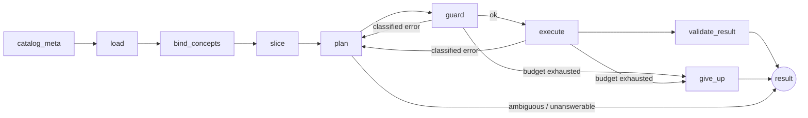

# SemantIQ logic

## Reading a semantic model

1. **Token.** MSAL `acquire_token_for_client` with scope `https://analysis.windows.net/powerbi/api/.default`. The token is cached and refreshed 5 minutes before expiry under a lock, so concurrent requests trigger one refresh.
2. **Schema (XMLA_Test method).** Live reads use **ADOMD.NET** (`xmla_client.execute_dax_sync`) with  
   `Data Source=powerbi://api.powerbi.com/v1.0/myorg/{workspace};Initial Catalog={model};User ID=app:{client}@{tenant};Password=...`  
   — not REST `executeQueries`. Required INFO.VIEW: `TABLES()`, `COLUMNS()`. Optional on failure: `MEASURES()`, `RELATIONSHIPS()`, `HIERARCHIES()`.  
   REST resolves workspace and dataset **names** for the connection string; `isOnDedicatedCapacity=false` only logs a warning (XMLA is still attempted).  
   Service principal only — no EffectiveUserName on the portal path.
3. **Normalise.** Results become `SemanticModel` objects: tables, columns (data type, description, hidden), measures (expression, format string, display folder) and relationships (cardinality, active, cross-filter).
4. **Cache.** Metadata is the same for every user, so it is cached per `(workspace, dataset)` for `METADATA_CACHE_TTL_S`. A per-key lock means 20 simultaneous first requests cause one load.

## Local catalog metadata (`pbi_semantic_metadata`)

Portal menu reports are exported to `pbi_semantic_metadata/` (see that folder’s README). `catalog.json` lists workspace, report, dataset ids, menu paths, datasource types, and measure/table names. `model.json` per dataset caches INFO.VIEW schema for offline hydrate.

**Enriched catalog** (`semantic_model_catalog_enriched.jsonl`) adds business domains, entities, and systems at dataset grain for retrieval — not physical column names.

**Ontology** (`Workspace_semantic_metadata/ontology/`): concepts, aliases, per-dataset bindings (from XMLA only), visual label map, and rules (e.g. fleet count = DISTINCTCOUNT of IMO, not vessel name). Promote glossary **and** ontology alias/rule patches through `scripts/apply_learning.py` and reviewed `learning/proposals/` — never auto-write from a single chat. In-thread `learned_hints` (orchestrator checkpoint) may adjust routing and `bind_concepts` hints for the same conversation only.

**Automatic refresh (`sync_runner.run_sync`, every `METADATA_SYNC_INTERVAL_S`, default 3600, started from the app lifespan; calls never overlap):**

1. `inventory_sync` re-reads workspaces, datasets and reports from Power BI REST and rewrites `semantic_model_catalog.jsonl` + `report_lookup_index.jsonl` atomically. Existing enrichment (business domains, risk, governance) is preserved; unreadable workspaces are left untouched; vanished datasets are archived to `semantic_model_catalog.removed.jsonl`.
2. Portal menu rows come from the Next route `GET /api/smart/catalog` (service JWT, audience `bi-portal-catalog`; `PORTAL_CATALOG_URL`), falling back to the `BI_REPORT_DB_*` Postgres read. `sync_catalog` maps each row to its dataset through Power BI REST and writes `portal_report_semantic_catalog.jsonl`.
3. A dataset is re-extracted only when its portal hash, report name or **live** refresh (REST `get_dataset_freshness`) changed, or a previous extraction failed. An incremental run with no changes extracts nothing.
4. After extraction, `ontology_builder` regenerates `concept_bindings.auto.jsonl` for the refreshed datasets (unambiguous column matches only; ambiguous ones go to `concept_bindings.review.jsonl`). Reviewed rows in `concept_bindings.jsonl` always win. Readers reload on file change.
5. `ontology_proposer` drafts alias additions into `learning/proposals/` for review. It never edits the live ontology.

**HITL learning loop (no ML):** chat corrections land in analytics `corrections`; `scripts/generate_learning_proposals.py` scores them into draft proposals; approvers use `/admin/smart-learning` or `apply_learning.py --apply` (author ≠ approver, retrieval eval gates). `ontology_add` is add-only (aliases, `business_aliases`, allowlisted `rules_patch`). `concept_bindings.jsonl` and prompts are unchanged by this loop.

### Handymax / SPPL / Oct 2026 (RCA)

Wrong report (Maersk Tankers title overlap on “tankers”), visual `Type Group` mistaken for subtype filter, unvalidated SPPL/date columns, and visual labels treated as measures. SMART retrieval now boosts Fleet Count titles and blocks `open_report` when ontology/metadata scores are strong. SemantIQ binds filters before DAX planning and validates DISTINCTCOUNT when a zero looks suspicious.

Build: `python -m pbi_semantiq_agent.build_semantic_metadata` (requires `BI_REPORT_DB_*` and Power BI SP).

## Two-layer architecture (production)

| Layer | Code | Responsibility |
|---|---|---|
| SMART orchestrator | `smart_orchestrator/graph.py` | Intent, hybrid BM25 + vector retrieval, report selection/clarification, SSE streaming, batch, checkpoints, summarise/verify |
| SemantIQ MCP subgraph | `pbi_semantiq_agent/agent.py` | Catalog hydrate, ontology bind, query plan, DAX, guard, XMLA execute, result validation |

**Report → semantic model resolution (deterministic):**

1. `(workspace_id, report_id)` on MCP `answer_question` / SMART `query`.
2. `CatalogStore.resolve_report_dataset` → portal `portal_report_semantic_catalog.jsonl`, then `semantic_model_catalog.jsonl` `reports[]`, then MCP `resolve_report_model` REST.
3. XMLA always uses `dataset_workspace_id` when the dataset lives in another workspace.

**SMART retrieval:** `CatalogRetriever` (BM25 + optional Pinecone) with ontology boosts and `catalog_hard_veto` (fleet/vessel inventory counts—including “no of handymax tankers …”—route to Fleet Count Vessel Portal dataset `6fe28c18-151c-4b05-a696-979f0906ddee`, not Maersk Tankers/MBR titles).

## `answer_question` sub-graph

| Node | Rule |
|---|---|
| `catalog_meta` | Resolve ids from `report_id` when provided; else token match on portal catalog; attach data connection summary |
| `load` | When PBI credentials are set (`metadata_prefer_live_xmla`, default true): cached live **INFO.VIEW via XMLA** first; `model.json` disk artifacts only if XMLA fails. Without credentials: disk then XMLA. |
| `bind_concepts` | Ontology concepts + `concept_bindings.jsonl`; emits deterministic `QueryPlan` (`query_plan.py`) |
| `slice` | Keyword relevance on schema; ontology adjusts measure scores (e.g. down-rank `Type Group`) |
| `plan` | LLM (`semantiq_dax.md`) receives **QUERY PLAN**, **CANONICAL BINDINGS**, and **SCHEMA** — never schema alone |
| `guard` | `dax_guard.validate`; bounded repair via `dax_recovery.classify_dax_error` (syntax/metadata/execution budgets, max 3 attempts) |
| `execute` | XMLA as **service principal** only (`user_email` audit-only on portal path) |
| `validate_result` | Zero vs empty; independent validation DAX with `TREATAS` **filter literals** and half-open / MONTH+YEAR date clauses from `query_plan`; `reconcile_values` detects **filter_leakage** (planned ≠ validation when time filter is mandatory) and loops to `plan` |
| `guard` | `dax_guard.validate` plus `filter_preservation.check_filter_preservation` — mandatory period filters must appear in DAX before XMLA execute |
| `give_up` | `query_failed` with candidates — never a fabricated number |

**Query filter extraction (`query_plan.py`):** Deterministic `time_filter` (month/year, quarter, calendar year, relative last/this month, between-dates) with `start_date`, `end_date_exclusive`, and `mandatory`. Dimension literals: vessel subtype/type, manager (SPPL or `manager <code>`), owner name after “owner …”, status (open/closed/pending, exclude-closed). Incident questions set `count_incidents` intent.

**Calendar date binding (`metadata.resolve_calendar_date` + `bind_concepts`):** After resolving the fact event date (`DATE_OF_INCIDENT` unless reported/created), upgrade `reporting_period` to `Calendar[Date]` when an INFO.VIEW relationship connects the fact date to a Calendar/DimDate table (active preferred; inactive paths prompt `USERELATIONSHIP`). `SchemaSlice` DATE FILTERS list inactive calendar relationships too.

**Filter guard (`filter_preservation.py`):** Before XMLA execute, every mandatory period and dimension literal must map to a bound column and appear in DAX (per-value `TREATAS` or explicit predicates—not a single unrelated `TREATAS`). Rejects `ALL`/`REMOVEFILTERS` on date/Calendar columns and measures that clear calendar/date context only.

**Post-execute validation (`validation_dax` + `reconcile_values`):** Independent `CALCULATE` with the same TREATAS + date clauses (no `ALLSELECTED()` fallback). `filter_leakage` when planned and validation counts diverge under any mandatory filter (time or dimensions).

**SMART retrieval (incidents):** Portal Incident Dashboard is boosted; bare workspace **Incident** is penalized but not hard-vetoed so `_unread_model` can retry a readable dataset when the dashboard model fails to load.

State fields (`SemantiqState`): `question`, `workspace_id`, `dataset_id`, `report_id`, `bindings`, `query_plan`, `repair_counts`, `error_class`, `plan`, `guard`, `result`, `timings`.

## DAX guard

A query is rejected unless all of these hold:

- it starts with `DEFINE` or `EVALUATE` and has exactly one `EVALUATE`;
- it is at most 8,000 characters;
- every `'Table'[Name]`, `Table[Name]`, `'Table'` and `[Name]` reference exists in the model, or was defined in the query (`DEFINE MEASURE`, `VAR`, or a string alias in `SUMMARIZECOLUMNS`).

Comments and string literals are masked before checking, so text inside them cannot fake or hide references.

If there is no `ORDER BY` / `START AT`, the `EVALUATE` body is wrapped as `TOPN(PBI_MAX_ROWS + 1, ...)`, so truncation can be detected. DAX over XMLA is read-only.

## Confidence components

| Component | Value |
|---|---|
| `schema_match` | 1 if the guard passed |
| `query_success` | 1 if Power BI returned rows (even zero rows) |
| `intent_clarity` | 1.0 clear, 0.99 assumed, 0 ambiguous / unanswerable |

SMART multiplies these with its own grounding score.

## Schema search (`search_model`)

The same tokeniser scores tables, columns and measures. Measures get a +0.2 boost and tables +0.1, so business metrics rank first. Hidden objects are never returned.

## MCP tools (executed, not stubs)

| Tool | Transport |
|---|---|
| `list_*`, `resolve_report_model`, `get_dataset_freshness` | Power BI REST |
| `get_model_schema`, `search_model`, `run_dax`, `validate_dax`, `answer_question` | XMLA + schema cache (SP only) |
| `search_catalog_metadata`, sync/status routes | Local metadata under `PBI_METADATA_ROOT` |

## Streaming and concurrency

SMART `POST /chat` SSE: `step`, `delta`, `message`. SemantIQ `ainvoke` per question (stateless MCP). Orchestrator uses per-conversation locks, `PBI_MAX_CONCURRENCY`, and MCP per-agent semaphores. XMLA runs in `asyncio.to_thread`.

## Evaluation

- Offline retrieval: `scripts/retrieval_eval.py`
- Unit: `tests/test_ontology_bind.py`, `tests/test_query_plan.py`, `tests/test_catalog_disk.py`
- Live-gated: `tests/regression/test_handymax_sppl_oct2026.py` (expected 32 only as assertion when XMLA + bindings available)

## Known limitations

- No per-user EffectiveUserName / RLS on XMLA in the current portal path (documented; `run_dax` / `answer_question` use service principal).
- `concept_bindings.jsonl` must be populated via `scripts/apply_learning.py` after validated XMLA inspect — not auto-written from chat.
- Premium / Fabric / PPU capacity required for live XMLA.
