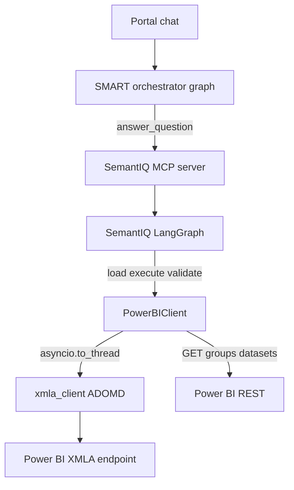
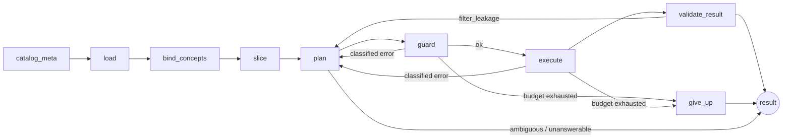

# XMLA connection logic

How the portal agents connect to Power BI semantic models, read schema via DAX, and run analytical queries. This document focuses on **connection and transport**. Ontology, filters, guard rules, and catalog build are in [`LOGIC.md`](LOGIC.md).

**Reference implementation (working XMLA pattern):** `WIP/BI Portal Revamp/XMLA_Test/semantic_chat_app.py` (`run_dax`, `_adomd`, `load_schema`).

---

## Executive summary

1. The **portal chat** is handled by **SMART** (`smart_orchestrator/graph.py`), which selects a report/dataset and calls the **SemantIQ MCP** tool `answer_question` (`pbi_semantiq_agent/server.py`).
2. **SemantIQ** runs a **LangGraph** sub-graph (`pbi_semantiq_agent/agent.py`) that loads schema and executes user DAX.
3. **All DAX**—schema `INFO.VIEW.*` and analytical queries—runs over **XMLA** through **ADOMD.NET** (`xmla_client.py`), not Power BI REST `executeQueries`.
4. **Power BI REST** is used for MSAL tokens, workspace/dataset **name resolution** (GUID → XMLA `Data Source` / `Initial Catalog`), and inventory APIs.

---

## High-level architecture



| Layer | File | Role |
|-------|------|------|
| Orchestrator | `smart_orchestrator/graph.py` | Intent, report selection, MCP `answer_question` |
| MCP entry | `pbi_semantiq_agent/server.py` | Exposes tools; `answer_question` → `SemantiqAgent.answer()` |
| Graph + DAX | `pbi_semantiq_agent/agent.py` | LangGraph: catalog → load → plan → guard → execute |
| REST + bridge | `pbi_semantiq_agent/powerbi_client.py` | Token, resolve names, `execute_dax` |
| XMLA transport | `pbi_semantiq_agent/xmla_client.py` | ADOMD connection string, sync DAX reader |
| Schema parse | `pbi_semantiq_agent/metadata.py` | `INFO.VIEW` DAX → `SemanticModel` |

---

## SemantIQ LangGraph flow

**Entry:** `SemantiqAgent.answer(question, workspace_id, dataset_id, user_email, report_id=...)` builds `SemantiqState` and calls `self.graph.ainvoke(state)`.



| Node | What it does | XMLA / model |
|------|----------------|--------------|
| `catalog_meta` | Resolve `workspace_id`, `dataset_id`, optional `report_id` from portal catalog | No XMLA |
| **`load`** | `get_model` → live schema or disk fallback | **Yes: `INFO.VIEW` over XMLA** |
| `bind_concepts` | Ontology + `QueryPlan` | In-memory model only |
| `slice` | Relevant schema slice for the LLM | In-memory |
| `plan` | LLM produces `DaxPlan` | No XMLA |
| `guard` | `dax_guard`, filter preservation | No XMLA |
| **`execute`** | Run planned DAX | **Yes: analytical DAX over XMLA** |
| `validate_result` | Validation DAX, filter leakage checks | **Yes: optional extra DAX** |
| `give_up` | `query_failed` with candidates | — |

Conditional edges (see `agent.py` `_build`, `_after_guard`, `_after_execute`, `_after_validate`):

- **plan → guard → execute** on success.
- **guard / execute → plan** when `classify_dax_error` + `can_retry` allow repair (bounded attempts).
- **execute → validate_result** when status is `ok` and bindings exist.
- **validate_result → plan** on `filter_leakage` when retry budget allows.

---

## Reading the semantic model (schema load)

### DAX queries (`metadata.py`)

`QUERIES` map keys to DAX:

| Key | DAX | Required |
|-----|-----|----------|
| `tables` | `EVALUATE INFO.VIEW.TABLES()` | Yes |
| `columns` | `EVALUATE INFO.VIEW.COLUMNS()` | Yes |
| `measures` | `EVALUATE INFO.VIEW.MEASURES()` | No (empty on failure) |
| `relationships` | `EVALUATE INFO.VIEW.RELATIONSHIPS()` | No |
| `hierarchies` | `EVALUATE INFO.VIEW.HIERARCHIES()` | No |

`load_model_extended` runs required views first, then optional. Each row set is parsed into `SemanticModel` (tables, columns, measures, relationships, hierarchies).

### Call chain

```
_load (agent.py)
  → get_model(workspace_id, dataset_id, user)
      → load_model(client, ...)  [metadata.py]
          → execute_dax_with_rls_retry(...)  [per INFO.VIEW key]
              → PowerBIClient.execute_dax(...)
                  → xmla_client.execute_dax_sync(...)
```

`execute_dax_with_rls_retry` does not set EffectiveUserName on the portal path; `user_email` is audit/context only.

### `get_model` policy (`agent.py`)

When `SemantiqSettings.pbi_configured` and `metadata_prefer_live_xmla` (default **true**):

1. Try cached live load via XMLA (`AsyncTTLCache` keyed by `(workspace_id, dataset_id)`).
2. On `PowerBIError`, fall back to `CatalogStore.load_model_from_disk` (`model.json` under `pbi_semantic_metadata/`).

If credentials are missing or live is not preferred: disk first, then XMLA.

`_LOAD_SOURCE` records `xmla` vs `disk` for logging.

### Contrast with XMLA_Test

| | XMLA_Test | SemantIQ |
|---|-----------|----------|
| Target | `PBI_WORKSPACE_NAME`, `PBI_CATALOG` from `.env` | `GET /groups/{id}`, `GET /groups/{id}/datasets/{id}` → workspace **name** + dataset **name** |
| Schema | `load_schema()` calls `run_dax` sequentially | `load_model_extended`; multiple async `execute_dax` calls (same ADOMD stack) |
| Output | Text blob for LLM prompt | Structured `SemanticModel` + cache |

---

## PowerBIClient: REST and XMLA split

File: `powerbi_client.py`.

### REST (Bearer token)

- **MSAL** `ConfidentialClientApplication.acquire_token_for_client` with scope `https://analysis.windows.net/powerbi/api/.default` (from settings).
- Token cached ~5 minutes before expiry; used only for `httpx` calls to `api.powerbi.com/v1.0/myorg/...`.
- **DAX is not sent via REST.**

### Resolving XMLA target (`_resolve_xmla_target`)

Before every `execute_dax`:

1. `GET /groups/{workspace_id}` → `name` (for `Data Source=powerbi://.../myorg/{name}`), `isOnDedicatedCapacity` (logged if false; **XMLA is still attempted**, same as XMLA_Test tolerance).
2. `GET /groups/{workspace_id}/datasets/{dataset_id}` → dataset `name` → **Initial Catalog** in the connection string.

Workspace allow-list: `PBI_ALLOWED_WORKSPACE_IDS` → `WorkspaceNotAllowed` if not listed.

### Running DAX (`execute_dax`)

1. Resolve `workspace_name`, `catalog`.
2. `asyncio.to_thread(self._xmla_runner, ...)` — default runner is `xmla_client.execute_dax_sync`.
3. Pass `tenant_id`, `client_id`, `client_secret` from `active_pbi_*` (Fabric or Power BI SP settings).
4. Normalize result: `clean_key` on column names; return `{columns, rows}`.

Concurrency: semaphore `pbi_max_concurrency`; metadata cache uses per-key locking so many first-time loads serialize at the model layer while ADOMD init is guarded in `xmla_client`.

---

## XMLA connection string and ADOMD execution

File: `xmla_client.py` (aligned with XMLA_Test `run_dax`).

### Connection string

```
Data Source=powerbi://api.powerbi.com/v1.0/myorg/{workspace_name};
Initial Catalog={catalog};
User ID=app:{client_id}@{tenant_id};Password={client_secret};
```

Service principal only on the portal path—no `EffectiveUserName` in SemantIQ’s `build_connection_string`.

### ADOMD bootstrap

1. Vendored assembly: `pbi_semantiq_agent/adomd/Microsoft.AnalysisServices.AdomdClient.dll`
2. **pythonnet:** add `adomd` to `sys.path`, `import clr`, `clr.AddReference("Microsoft.AnalysisServices.AdomdClient")`.
3. **`_load_adomd()`** caches `(AdomdConnection, AdomdCommand)` globally behind a **`threading.Lock`**. Parallel `INFO.VIEW` calls must not initialize pythonnet on multiple threads at once.
4. Per query: `AdomdConnection(conn_str)` → `Open()` → `AdomdCommand(dax, conn).ExecuteReader()` → rows/columns → `Close()`.
5. Errors surface as `RuntimeError` → `PowerBIClient` wraps as `PowerBIError("DAX query failed", detail=...)`.

### Credentials

`SemantiqSettings`: `PBI_TENANT_ID`, `PBI_CLIENT_ID`, `PBI_CLIENT_SECRET` (or Fabric equivalents via `uses_fabric_principal` → `active_pbi_*`). `pbi_configured` must be true for live XMLA.

---

## Analytical DAX path (after schema is in memory)

1. **`_plan`:** LLM (`prompts/semantiq_dax.md` + business context) returns `DaxPlan` (`intent`, `dax`, assumptions, etc.) using schema slice, `QueryPlan`, and bindings.
2. **`_guard`:** `dax_guard.validate` (syntax, row limits, model refs); `check_filter_preservation` for mandatory period filters.
3. **`_execute`:** `client.execute_dax(workspace_id, dataset_id, guard.dax)` → same XMLA path as schema load.
4. **`_validate_result`:** Optional validation DAX, `reconcile_values`, `filter_leakage` → may loop back to `plan`.

Retries: `dax_recovery.classify_dax_error` + `can_retry` on syntax, metadata, execution, and filter classes within attempt/repair budgets.

---

## SMART orchestrator touchpoints

File: `smart_orchestrator/graph.py`.

- Resolves report/dataset from portal catalog and Pinecone/BM25 retrieval where needed.
- Dispatches MCP: `agents.call("pbi_semantiq_agent", "answer_question", { question, workspace_id, dataset_id, user_email, report_id? })`.
- **`_semantiq_load_failure(result)`** — if SemantIQ returns `model_unavailable` or certain `error` messages about reading the model, SMART shows the unreadable-model message (`smart_orchestrator/errors.py`), often after a successful **report title** match but failed **`load`** node.

Stream progress: SSE labels such as “Searching the semantic model” (schema tools) and “Preparing, validating, and executing the analysis” (`answer_question`).

---

## XMLA_Test vs SemantIQ (summary)

| Aspect | XMLA_Test | SemantIQ |
|--------|-----------|----------|
| Workspace / catalog | `.env` names | REST resolve by GUID |
| Schema | `load_schema()` → `run_dax(INFO.VIEW.*)` | `load_model_extended` → same DAX families |
| User questions | Streamlit + LLM + `run_dax` | LangGraph + MCP + `execute_dax_sync` |
| Auth in XMLA | SP in connection string | Same (portal: no EffectiveUserName) |
| REST executeQueries | Not used (401 on test model) | Not used |

---

## Key files

| File | Purpose |
|------|---------|
| `server.py` | MCP `answer_question`, agent wiring |
| `agent.py` | LangGraph, `get_model`, load/execute nodes |
| `powerbi_client.py` | MSAL, REST, `execute_dax`, XMLA target resolution |
| `xmla_client.py` | ADOMD, connection string, sync DAX |
| `metadata.py` | `INFO.VIEW` queries, `SemanticModel` |
| `settings.py` | `pbi_*`, `metadata_prefer_live_xmla`, allow-lists |
| `smart_orchestrator/graph.py` | Portal orchestration → SemantIQ |

---

## Operational prerequisites

- Python environment with **`pythonnet>=3.0`** and packaged **`adomd/*.dll`** (see `pyproject.toml` `package-data`).
- Service principal with **Build** / XMLA read access on the workspace semantic model (Fabric/Premium XMLA endpoint behavior as in your tenant).
- Optional disk fallback: `pbi_semantic_metadata/.../model.json` from `pbi-build-metadata`.
- Do not install the unrelated PyPI package named **`clr`**; it shadows pythonnet’s `clr` module.

For deeper product behavior (ontology, incident filters, guard rules), see [`LOGIC.md`](LOGIC.md). Filter extraction, Calendar binding, and pre/post-execute filter validation are described there; this file covers connection and transport only.