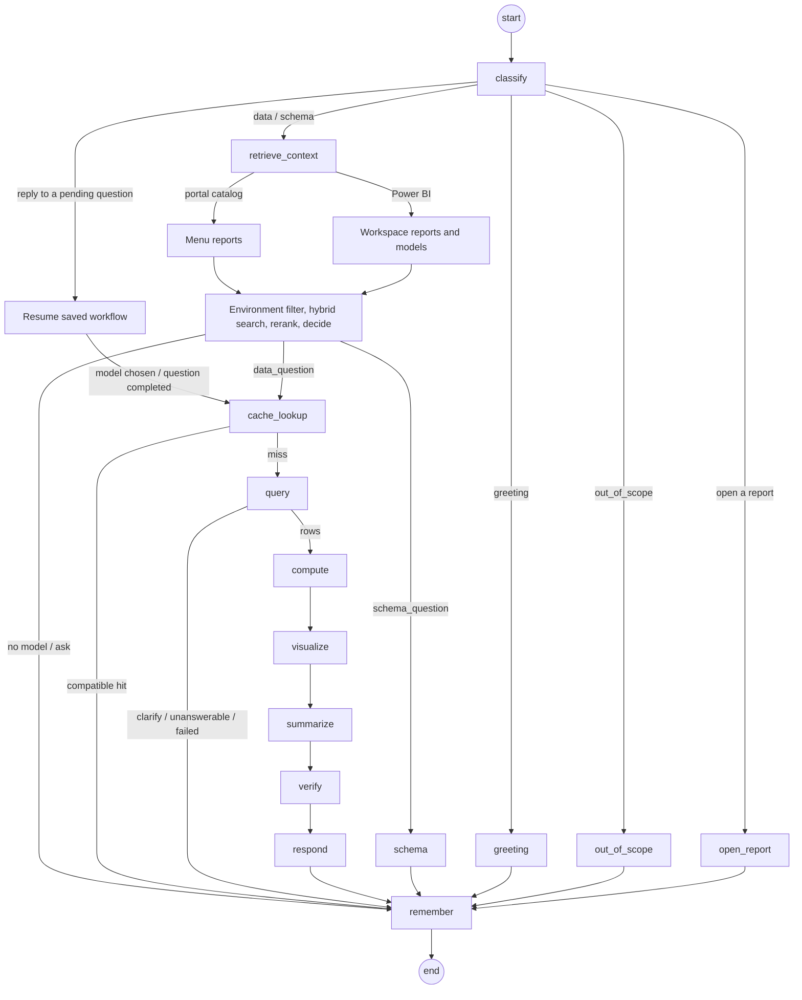

# SMART logic

## Graph

The menu lookup and the Power BI workspace lookup start in the same step. Neither waits for the other. A question does not require a report to be open.

When the portal catalog loaded, a workspace model is used only if its report or dataset is in that user's menu. When `catalog_unavailable` is set, the workspace list is the source and DAX still runs as the signed-in user (row-level security). Opening a report while the catalog API is down returns `Try later, facing issues in connecting report databases`. If both the catalog and Power BI discovery fail, the reply is `SMART is currently down, raise an issue to bisupport@synergyship.com`.

Workspace report and model names are cached in the orchestrator process for `WORKSPACE_INVENTORY_TTL_S` seconds (default 300). The cache is not a permission cache: the user's catalog is applied on every question, and query execution still impersonates the user. Power BI tokens keep the existing MSAL refresh in SemantIQ.

| Node | What it does | Agent |
|---|---|---|
| `classify` | First checks the thread's `pending` record: a matching reply resumes the saved workflow, "cancel" clears it. Otherwise the LLM (prompt `intent.md`) returns `intent`, `wants_visual`, `preferred_visual` and a stand-alone question rewritten from the last turns. Falls back to keyword rules. `open_report` is only an explicit request to open a report. | LLM |
| `retrieve_context` | Starts portal metadata hints, menu matching and workspace discovery together (one parallel step), then after hybrid search and rerank an **LLM reasoning step** (`llm_rerank.py`, prompt `rerank.md`) reads the top candidates' titles, menu paths, descriptions and schema and picks one, asks, or confirms the deterministic choice. It can only choose among eligible, authorised candidates and falls back to the deterministic decision on any failure, invalid key or low confidence (`LLM_RERANK_*` settings). Then builds the user's authorized pool, classifies PROD/DEV/ARCHIVE, removes environments the user did not ask for, runs hybrid search and the decision ([RETRIEVAL.md](RETRIEVAL.md)). Selects a model, asks (saving `pending`), or reports no match. | SemantIQ |
| `cache_lookup` | Reuses an earlier answer only for the same security scope, dataset, query signature and dataset refresh. | SemantIQ (freshness) |
| `schema` | `search_model` and lists matching tables, columns and measures with descriptions. | SemantIQ |
| `query` | `answer_question`: DAX is written, validated and executed as the user. Non-`ok` results become clarification (saved as `pending`), info or low-confidence messages. If Power BI refuses the model, only equally ranked candidates that passed the same environment filter are retried; SMART never falls back to a keyword-matched draft. | SemantIQ |
| `compute` | `stats.compute_stats`: totals, averages, min/max, top/bottom, share and first-to-last change. | code |
| `visualize` | Skipped for a single-row answer that asked for no visual. Otherwise `generate_visual`; if N.O.V.A. fails, the answer continues without a chart. | N.O.V.A. |
| `summarize` | LLM (prompt `summarize.md`) words a summary and highlights from the stats and the first 20 rows. | LLM |
| `verify` | Grounding check: each number in the text must match a row value or a stat. Any miss replaces the text with the template summary. | code |
| `respond` | Builds the final message. Confidence below the threshold turns it into a clarifying `low_confidence` message. | code |
| `respond` (labels) | A non-production source is always named, e.g. "(Source: Injury_Data_Draft, draft/test)". | code |
| `remember` | Appends the turn to history (last 12 entries) and records the interaction, repeats and failure patterns. | code |

## Confidence

`score = schema_match x query_success x intent_clarity x grounding`

- `schema_match`: 1 when the DAX guard passed.
- `query_success`: 1 when Power BI executed the query.
- `intent_clarity`: 1 for clear, 0.99 for "assumed" (assumptions are shown), 0 for ambiguous.
- `grounding`: share of numbers in the final text that trace to data (1.0 after the template fallback).

With the default threshold of 0.98, an answer is only shown when every check passed.

## Concurrency

- Each request is one async graph run; independent users never share state.
- Memory is keyed by `email:conversation_id`, so threads cannot be read across users.
- Per-turn fields (`dataset`, `semantiq`, `stats`, `visual`, `summary`, `confidence`, `response`, `retrieval`, `cache`) are reset at the start of each run; only `history` and `pending` carry over.
- Runs for the same thread are serialised by a per-thread lock, so a quick follow-up cannot race the pending clarification.
- The semantic cache shares one SemantIQ call between identical concurrent questions in the same security scope.
- `asyncio.Semaphore(MAX_CONCURRENT_REQUESTS)` caps graph runs; agent calls have their own per-agent semaphore and timeout.

## Step events

Nodes emit `{"step", "status", "label", "agent", "ms"}` through LangGraph's custom stream. The panel shows them live and keeps them under "Steps" on the answer.
