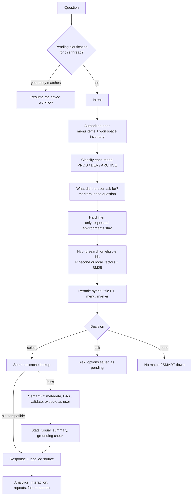

# SMART retrieval, environment filter, cache, conversation state and learning

Principle: retrieval precision over retrieval volume. A draft, test, development or archived
model is never chosen as the production source because it scores higher. Non-production models
are removed before ranking unless the user asks for them.

## Pipeline

Code: `ranking.py` (`CatalogRetriever`), `hybrid_index.py`, `bm25.py`, `vector_store.py`,
`embeddings.py`, `ingestion.py`, `environment.py`, `query_norm.py`, `semantic_cache.py`,
`conversation.py`, `analytics.py`, wired together in `graph.py`.

## Environment classification (`environment.py`)

Every report and semantic model gets `environment` = `PROD`, `DEV` or `ARCHIVE`, both when it
is indexed (document metadata, Pinecone metadata) and on every retrieval.

- Names are split into tokens on case changes, digits, `_`, `-`, spaces and punctuation:
  `Injury_Data_Draft`, `InjuryDraft`, `Injury-v2`, `INJURY_REPORT_DRAFT` all expose the marker as a
  whole token. Substrings never count: `Contest`, `Latest`, `Oldham`, `Developer Portal`, `Bold`
  stay PROD.
- DEV terms: `REPORT_ENV_DEV_TERMS` (draft, test, dev, development, uat, ...). Version tokens
  `v1`..`vN` and `version 2` are DEV.
- ARCHIVE terms: `REPORT_ENV_ARCHIVE_TERMS` (archive, backup, old, deprecated, ...). ARCHIVE wins
  over DEV when both appear.
- Production business phrases that contain a marker word (`REPORT_ENV_PROD_PHRASES`, e.g.
  "draft survey", "drug test") are removed before classification.
- `REPORT_ENV_OVERRIDES` maps a dataset id, report id or exact title to an environment. Use it for
  reviewed false positives such as a production model called "Development Projects Budget".
- `REPORT_ENV_CLASSIFY_WORKSPACE=true` also classifies by workspace name, so every model in a
  workspace named "Fabric F64 - Testing" is DEV.

### What the user asked for

`EnvironmentPolicy.requested(question, candidates)` reads markers in the question with the same
token rules. Strong markers (`dev`, `uat`, `archive`, `v2`, ...) always count. Weak markers
(`REPORT_ENV_QUERY_WEAK_TERMS`: draft, test, old, ...) count only next to a report or model word
("draft report", "test model") or when they occur in a candidate's name. "Show injury draft
report" unlocks DEV; "draft survey results" and "show old incidents" do not.

Without a request only PROD is eligible. With a request the requested environment and PROD are
eligible and the requested one is preferred. Scores are never penalised; ineligible models are
simply not searched.

Authorized override: a user listed in `NONPROD_OVERRIDE_USERS` may send
`context.include_nonprod=true`. That makes all environments eligible but does not make them
preferred; a non-production result is always labelled. Anyone else sending the flag gets PROD only.

## Indexing (`ingestion.py`, `hybrid_index.py`)

One document per authorized report or model (key `workspace|dataset`, or `workspace|report:id`
when a report has no dataset). Text = title (x3), menu path (x2), description, glossary
expansions (canonical terms and synonyms found in the text) and, once fetched, table, column and
measure names from SemantIQ `get_model_schema` (first 600 tokens). Metadata = environment,
markers, ids, source, workspace.

- `HybridIndex.sync` compares a digest per document and only re-embeds changed documents.
  BM25 and the local vector store update immediately; Pinecone upserts run in the background.
  Documents that leave the catalog are deleted from both stores, so BM25 and Pinecone stay in sync.
- `ModelMetadataIndexer` fetches schemas in the background (PROD first, bounded concurrency,
  `INDEX_METADATA_MAX_MODELS`, refreshed after `INDEX_METADATA_TTL_S`). A schema change invalidates
  the semantic cache for that model.
- Pinecone is used only when every eligible id is already stored with its current digest.
  Otherwise, or on error or timeout, the local store answers, so results never depend on a
  half-synced index. Queries always carry the filter
  `{"environment": {"$in": eligible}, "doc_id": {"$in": eligible ids}}`.

## Hybrid search and reranking (`ranking.py`)

1. BM25 (`bm25.py`) over the eligible ids, normalised to 0..1 by the best hit.
2. Cosine similarity from Pinecone or the local store.
3. `hybrid = RETRIEVAL_VECTOR_WEIGHT * vector + RETRIEVAL_BM25_WEIGHT * bm25`.
4. Rerank: `score = RERANK_HYBRID_WEIGHT * hybrid + RERANK_TITLE_WEIGHT * title_F1 + RERANK_MENU_WEIGHT * menu + RERANK_MARKER_WEIGHT * marker`.
   Title F1 compares question subject tokens (stems, glossary canonical terms, CamelCase parts)
   with title tokens without generic words such as report or dashboard.
5. A candidate is relevant only with real evidence: a title subject hit, a menu hit, a strong
   keyword hit (normalised BM25 >= 0.5) or a semantic hit (vector >= `RETRIEVAL_VECTOR_FLOOR`), and
   `score >= RETRIEVAL_MIN_RELEVANCE`.

## Decision

In order:

1. Explicit environment request: best requested-environment model (marker match, plain title,
   coverage, score). Two equally plain models (e.g. two drafts) -> ask.
2. Plain model: a PROD title that is only the subject ("Injury") wins over longer titles; other
   equally plain models are kept as retries when Power BI refuses the first.
3. Confident match: `score >= RETRIEVAL_SELECT_THRESHOLD`, lead `>= RETRIEVAL_SELECT_MARGIN` and a
   lexical hit.
4. The open report, when it is relevant.
5. Two or more relevant models -> ask, at most `RETRIEVAL_MAX_OPTIONS` options.
6. One relevant model: select when it has a lexical hit, otherwise ask ("weak match").
7. Only non-production models match -> ask, offering them labelled ("only_nonprod"). They are
   never used silently.
8. Nothing -> the normal no-match message, or `SMART is currently down, raise an issue to
   bisupport@synergyship.com` when discovery failed.

When Power BI cannot read the selected model (e.g. 401), SMART tries only equally ranked retries
that passed the same environment filter. It never broadens the search to keyword alternatives
after selection: a draft/test/archive model cannot be offered or selected as fallback for a failed
production model. If no eligible retry can be read, SMART returns `SMART is currently down, raise
an issue to bisupport@synergyship.com`.

## Semantic cache (`semantic_cache.py`)

A cached answer is reused only when all of these hold:

| Check | Rule |
|---|---|
| Security scope | `shared` only when the model is known to have no RLS (both rls flags false) and the catalog is up; otherwise `user:<email>`. Entries never cross scopes. |
| Authorization | The cached dataset is in the user's authorized set for this turn. |
| Dataset | Same workspace and dataset. |
| Signature | Same time window, numbers, grouping, visual and operators (max/min/trend/open/...); "injuries on 12 Oct" never reuses "injuries on 13 Oct". |
| Wording | Cosine of normalised question and filters >= `SEMANTIC_CACHE_SIMILARITY`. |
| Freshness | Same last-refresh id/time (SemantIQ `get_dataset_freshness`, cached `FRESHNESS_TTL_S`). A new refresh invalidates every entry for the dataset. |
| Age | `SEMANTIC_CACHE_TTL_S`, or `SEMANTIC_CACHE_UNKNOWN_FRESHNESS_TTL_S` when freshness is unknown. |

Identical concurrent questions in one scope share a single SemantIQ call (`single_flight`).
Cache hits are marked `cache.hit=true` and the portal shows "Recent result".

## Multi-turn state (`conversation.py`, `graph.py`)

- Thread id = `email:conversation_id`; LangGraph checkpoints keep `history` and `pending`.
  `MemorySaver` by default; set `CHECKPOINT_SQLITE_PATH` (needs `langgraph-checkpoint-sqlite`) for
  checkpoints that survive restarts.
- When SMART asks (model choice or a SemantIQ clarification such as "Monthly or vessel-wise?") it
  saves a `pending` record: kind, original question, intent, options, chosen dataset.
- The next message is matched to the options (ordinal, label, "use X", unique token overlap) or,
  for free clarifications, merged as "original question (reply)". The workflow resumes from the
  saved dataset without re-retrieval. "cancel" clears it; it expires after `PENDING_TTL_S`; after
  `MAX_CLARIFICATIONS` SMART asks for the full question instead of looping.
- Runs for the same thread are serialised by a per-thread lock; different threads run in
  parallel under `MAX_CONCURRENT_REQUESTS`.

## Feedback and learning (`analytics.py`, `scripts/`)

- Every turn is stored in SQLite (`ANALYTICS_DB_PATH`) with a hashed user id, outcome, model,
  environment, cache hit, confidence, retrieval trace and timings.
- `POST /feedback` (portal route `/api/smart/feedback`) stores thumbs up/down, a reason and an
  optional comment. Only the user who asked may rate an answer.
- Repeated questions in a thread (token Jaccard >= `REPEAT_SIMILARITY` within `REPEAT_WINDOW` turns)
  that stay unresolved create a failure pattern with a cause: `retrieval`, `routing`, `dax` or
  `response_quality`, and log `repeated_unresolved_question`.
- Nothing changes production automatically. The reviewed loop is:
  1. `python scripts/learning_review.py --days 14` - read-only report: outcomes, down-votes,
     repeated failures by cause, unknown words in unresolved questions.
  2. Write a proposal (glossary additions, evaluation cases that prove the fix, optional settings).
  3. `python scripts/generate_learning_proposals.py --days 14` — scores analytics `corrections`
     (instruction parse, clarification picks, feedback) into draft JSON under `learning/proposals/`.
  4. `python scripts/apply_learning.py <proposal> --approved-by <reviewer>` — the approver must not
     be the author; the extended evaluation set must have zero non-production leaks, accuracy
     `>= --min-accuracy` and no regression. `--apply` writes the glossary (version bumped), the
     evaluation set, and optional `ontology_add` into workspace ontology; settings are printed for
     deployment; every run is audited in `learning/audit/`. Portal: **Admin → SMART Learning** or
     orchestrator `GET/POST /learning/*` (set `LEARNING_ADMIN_USERS` in production).
  5. `python scripts/retrieval_eval.py` runs the evaluation set on its own; the test suite runs it too.

**Same-conversation overlay:** orchestrator persists `learned_hints` on the LangGraph thread (preferred
report/dataset, thread aliases). These affect rerank and SemantIQ `ontology_hints` until the thread
expires; they do not edit ontology files.

## Logs

JSON events: `catalog_retrieval` (request, eligible/filtered counts, selected, options, excluded,
timings, vector store), `semantic_cache` (hit or miss with reason), `semantic_cache_store`,
`semantic_cache_invalidated`, `pending_resumed`, `repeated_unresolved_question`, `turn_done`
(request id, outcome, environment, cache, total ms). User emails are not written to analytics.

## Configuration

All settings are in `.env.example` with defaults. Production needs:

| Item | Why |
|---|---|
| `PINECONE_API_KEY`, `PINECONE_INDEX_HOST` | Shared vector index. Create a serverless index with metric `cosine` and dimension = `EMBEDDING_DIMENSIONS`. Without them the in-process store is used (fine for one instance). |
| `EMBEDDING_MODEL` | A gateway embedding deployment the key may call. Empty = local hashing embedder (lexical-semantic, no typo tolerance). Changing the model or dimensions requires a new Pinecone namespace or index. |
| `NONPROD_OVERRIDE_USERS` | Users allowed to include non-production models. |
| `REPORT_ENV_OVERRIDES` | Reviewed false positives. |
| `CHECKPOINT_SQLITE_PATH` | Durable conversation state (optional package). |
| `ANALYTICS_DB_PATH` | Writable location for feedback and failure analytics (git-ignored `.data/`). |
